# ShoppingMate Card

Two dashboard cards for Home Assistant that turn a to-do list into a proper family shopping system, made for wall tablets and phones. One file gives you:

- **ShoppingMate List Card** (`custom:shoppingmate-list-card`): the shopping list next to a catalog of everything you usually buy. Tap an item to add it, tap it again for more.
- **ShoppingMate Calculator Card** (`custom:shoppingmate-calc-card`): an in-store calculator that works through the same list and adds up what you spend. It can optionally save each shop to a history calendar and a spend counter.

[](#) [](#) [](https://github.com/PrimusNZ/shopping-mate-card/blob/devel/LICENSE)

<br>

## Table of contents

**[`Screenshots`](#screenshots)**  **[`Intended use`](#intended-use)**  **[`Features`](#features)**  **[`Requirements`](#requirements)**  **[`Setting up`](#setting-up)**  **[`Configuration`](#configuration)**  **[`Catalog format`](#catalog-format)**  **[`Styling`](#styling)**  **[`Notes`](#notes)**  **[`License`](#license)**

<br>

## Screenshots

**ShoppingMate List Card**

| Tablet or kiosk | Light theme |
| --- | --- |
| 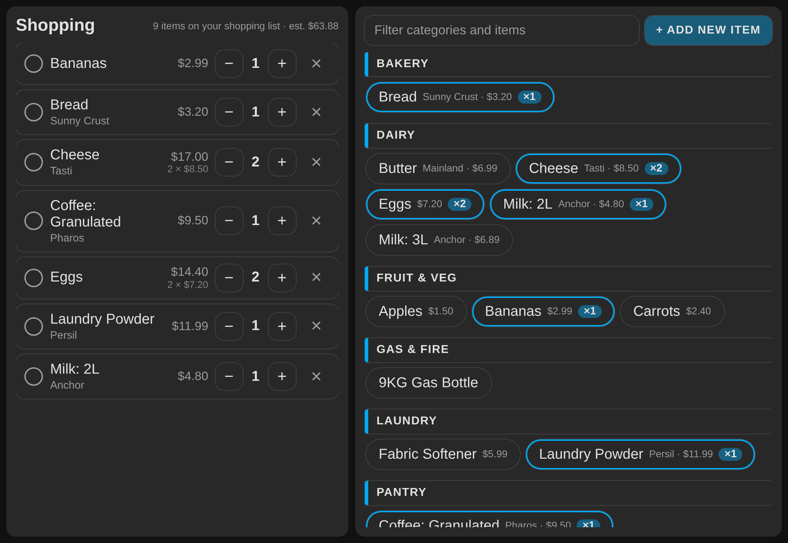 | 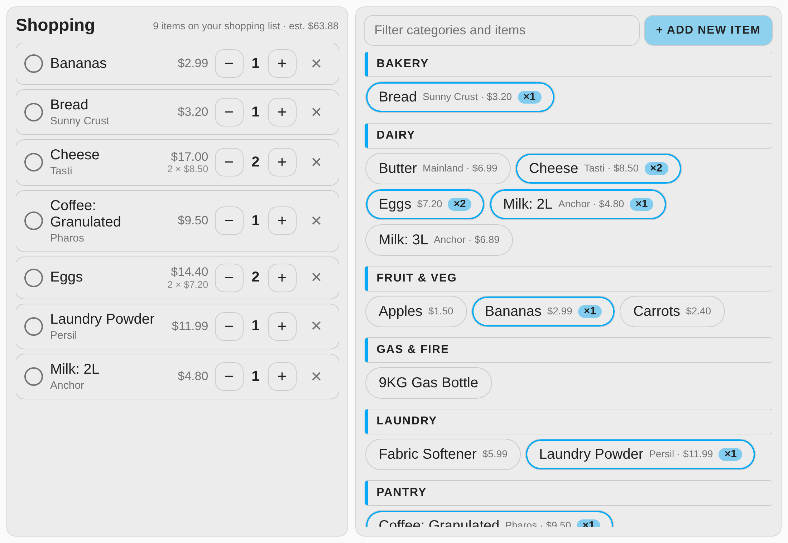 |

| Filtering the catalog | Add New Item |
| --- | --- |
| 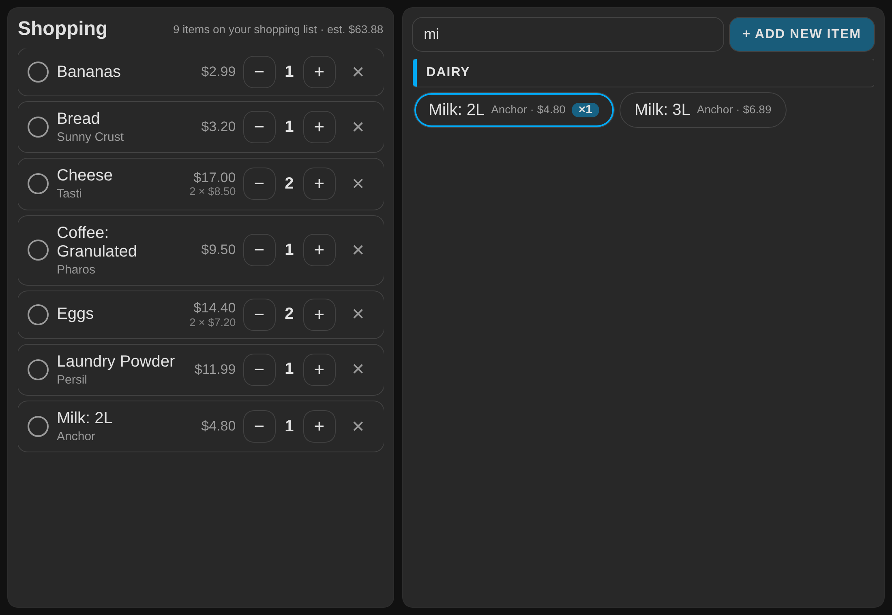 | 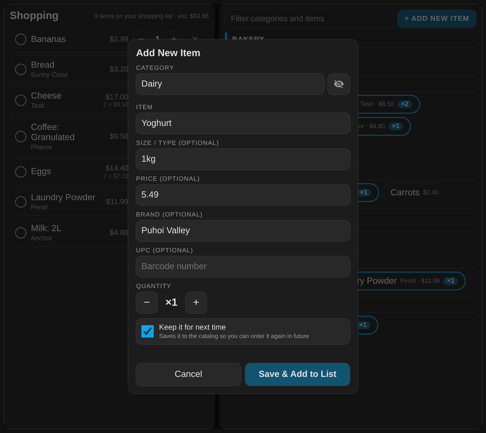 |

| Edit an item (long-press) |
| --- |
| 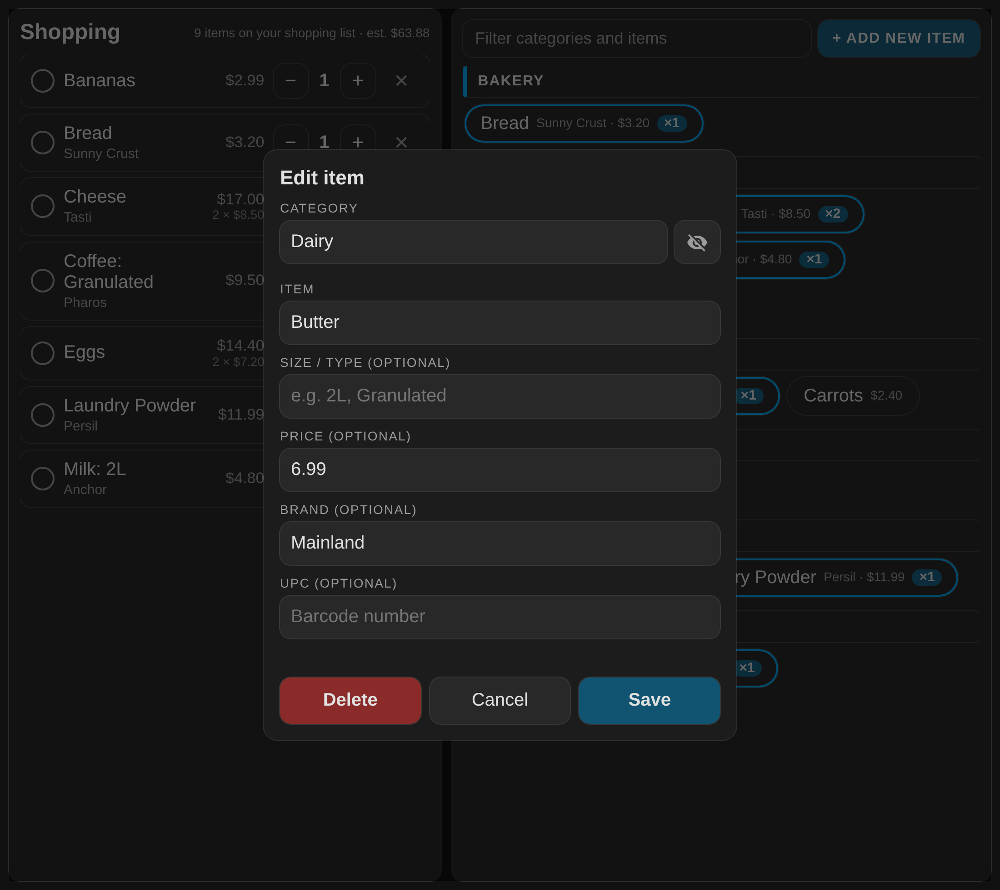 |

On a phone the list card shows one pane at a time:

| Shopping list tab | Add items tab |
| --- | --- |
| 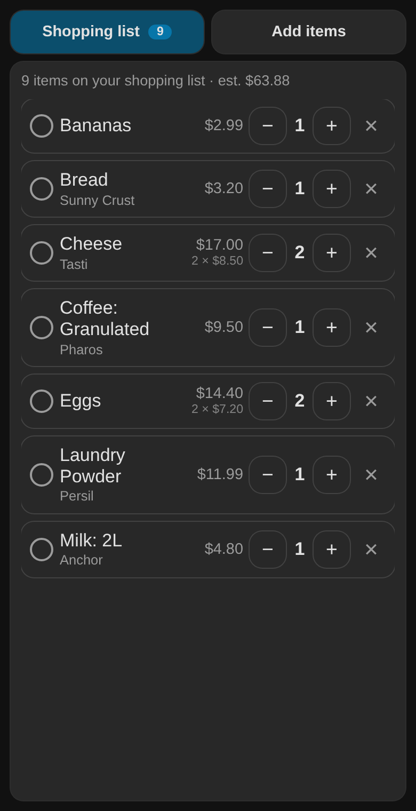 | 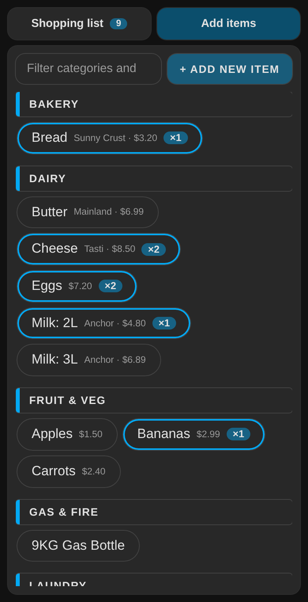 |

**ShoppingMate Calculator Card**

| Pricing items | Ready to start | Light theme |
| --- | --- | --- |
| 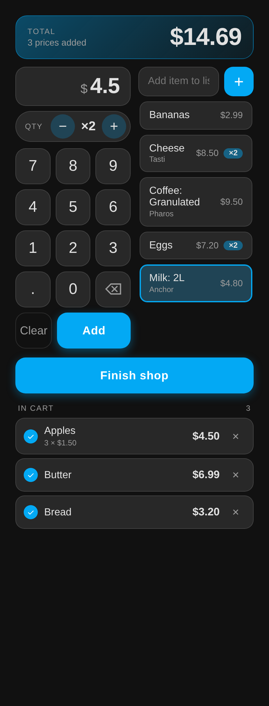 | 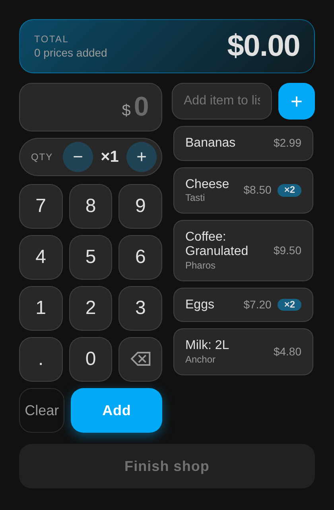 | 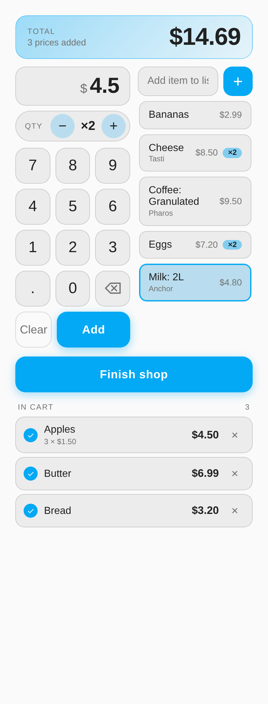 |

The calculator card can also run without the calculator (`calculator: false`): select an item, set the quantity and press Add to put it in the cart, with no prices.

| Calculator off | Light theme |
| --- | --- |
| 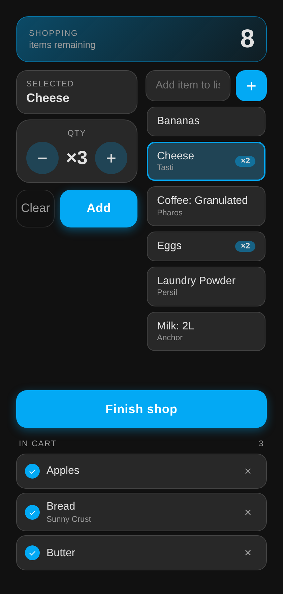 | 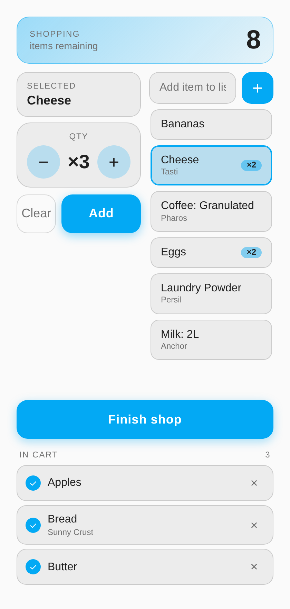 |

<br>

## Intended use

The cards are built around one routine:

1. **At home, on a wall tablet or kiosk.** Keep a catalog of the things you buy, grouped by category (Dairy, Pantry, Laundry and so on). When something runs out, tap it in the catalog and it lands on the shopping list. Anyone in the house can do this in a couple of taps, and items you have never bought before can be added on the spot and saved for next time.
2. **In the shop, on a phone.** Open the calculator on the same list. Pick an item, key in its price and quantity, and it is ticked off the list and added to a running total. The "In Cart" list shows what you have priced so far.
3. **Afterwards.** Press **Finish shop**. The ticked-off items are cleared from the list. If you turn on **Track spending** (optional), the shop is also saved as an event in a history calendar (every item with its quantity and price, plus the total) and the total is added to a running spend counter you can chart by week or month.

Both cards read and write the same shopping list, so the tablet at home and the phone in the shop always agree.

<br>

## Features

**ShoppingMate List Card**

- Two panes: the shopping list on the left, the catalog on the right. On a narrow screen (a phone) it switches to one pane at a time with two tabs.
- The header counts what is still to buy, for example "5 items on your shopping list".
- Tap a list row to tick it off. Use − and + to change the quantity, ✕ to remove it, and **Clear done** to remove everything ticked.
- The catalog is grouped by category, sorted A to Z, with a live filter that matches category and item names as you type.
- Items already on the list show how many you have.
- The header adds an estimated total ("5 items on your shopping list · est. $43.50") from the catalog prices, and says how many items have no price.
- Long-press a catalog item to rename it, change its size or type, move it to another category, or delete it.
- **+ Add New Item** adds something new. Type a category (existing ones are suggested as you type, and a new name creates a new category), the item, an optional size or type, a quantity, and whether to keep it in the catalog for next time.
- No duplicates: an item exists once in the catalog whatever its category, and adding something already on the list raises its quantity instead of adding a second row.
- The add and edit dialogs stay open when you tap outside them, so you can tap away to dismiss the on-screen keyboard on a small display. Use Cancel to close.

**ShoppingMate Calculator Card**

- Keypad, quantity control and a running total.
- The open items from the shopping list, A to Z. Tap one to select it, then **Add** a price. It is ticked off the list and moved to the **In Cart** list.
- Long-press an item to be asked whether to remove it from the shopping list.
- Picking an item pre-fills its saved catalog price; the first digit you type replaces it, and backspace edits it.
- An "Add item" field for anything you spot in the shop that was not on the list.
- ✕ on an In Cart line removes that price (and un-ticks the item if it has no other prices).
- **Finish shop** clears the ticked-off items. Optionally it also saves the shop to a calendar and a spend counter.
- What you have priced so far is kept in the browser until the shop is finished, so a refresh does not lose it.

Both cards have a visual editor in the dashboard editor.

<br>

## Requirements

- Home Assistant with at least one to-do list for the shopping list. The built-in [Local To-do](https://www.home-assistant.io/integrations/local_todo/) integration works well.
- A second to-do list for the catalog (the ShoppingMate List Card).
- Optional, for the calculator's shop tracking: a calendar that can create events, such as [Local Calendar](https://www.home-assistant.io/integrations/local_calendar/), and an `input_number` helper for the spend counter.

Install **ShoppingMate Card** from the **Marketplace** in Home Assistant (it is listed as a Dashboard card). There is nothing to download or add by hand. Once it is installed, add the cards to a dashboard as described below.

<br>

## Setting up

Create these once, then add the cards.

**1. The shopping list.** Add a Local To-do list called **Shopping List**. Its entity is `todo.shopping_list`.

**2. The catalog (ShoppingMate List Card).** Add another Local To-do list called **Shop Catalog** (`todo.shop_catalog`). Each item in it is one thing you can buy, written as `Category: Item` or `Category: Item | Size`. See [Catalog format](#catalog-format). You can fill it by hand in the to-do list, or just use **+ Add New Item** in the card and it writes the entries for you.

**3. Shop tracking (optional, ShoppingMate Calculator Card).** Skip this step if you don't want a history. Tracking is off by default: Finish shop simply clears the ticked-off items. To turn it on, switch **Track spending** on in the card's settings (or set `track_spending: true`) and fill in both fields in the **Spending history** section below it. If tracking is on and either is missing, the card shows an error. It only works with the calculator on: with the calculator off and tracking on, the card shows an error.

- Add a Local Calendar called **Shop History** (`calendar.shop_history`). Each finished shop becomes an event here, with every item, quantity and price in the description.
- Add a **Number** helper called **Shop Spend Total** (`input_number.shop_spend_total`). Give it a minimum of 0, a maximum high enough for your yearly spending, and a step of 0.01. Finish shop adds each shop total to it. If you want weekly or monthly charts, mirror it with a total-increasing template sensor and use that in a statistics or history graph card.

**4. Add the cards.** Edit your dashboard, choose **Add card** and pick **ShoppingMate List Card** or **ShoppingMate Calculator**, then fill in the form. Or use YAML:

```yaml
type: custom:shoppingmate-list-card
entity: todo.shopping_list
catalog_entity: todo.shop_catalog
title: Shopping
```

```yaml
type: custom:shoppingmate-calc-card
entity: todo.shopping_list
currency: "$"
# Optional shop tracking (needs the calculator)
track_spending: true
calendar_entity: calendar.shop_history
spend_entity: input_number.shop_spend_total
```

To use the same card without the calculator, add `calculator: false`:

```yaml
type: custom:shoppingmate-calc-card
calculator: false
entity: todo.shopping_list
title: Shopping
```

The calculator is best on its own phone view (a panel view works well) so it can fill the screen. The list card fills the height of its container, so give it a panel view or a full-height section as well. On the kiosk, put the list card in its own page.

**Optional: a notification when you finish.** With shop tracking set up, the calculator saves the shop one minute in the future and bumps the spend counter. An automation that triggers when `input_number.shop_spend_total` goes up can read the newest event from `calendar.shop_history` and send you the receipt, for example to a phone or a family chat.

<br>

## Configuration

### ShoppingMate List Card

| Name | Type | Requirement | Default | Description |
| --- | --- | --- | --- | --- |
| `type` | string | **Required** | | `custom:shoppingmate-list-card` |
| `entity` | string | Optional | `todo.shopping_list` | The to-do list that holds the shopping list. |
| `catalog_entity` | string | Optional | `todo.shop_catalog` | The to-do list that holds the catalog. |
| `currency` | string | Optional | `$` | Symbol shown before the estimated total in the header. |
| `title` | string | Optional | `Shopping` | Heading above the shopping list. Hidden on narrow screens, where the tabs take its place. |

### ShoppingMate Calculator Card

| Name | Type | Requirement | Default | Description |
| --- | --- | --- | --- | --- |
| `type` | string | **Required** | | `custom:shoppingmate-calc-card` |
| `entity` | string | Optional | `todo.shopping_list` | The to-do list that holds the shopping list. |
| `calculator` | boolean | Optional | `true` | Set to `false` to turn the calculator off. You still get the item list, the add-item field and the quantity stepper: select an item, change the quantity if it differs, press Add to put it in the cart, and Finish shop clears the cart from the list. There is no keypad, no prices, no total and no history entry. |
| `title` | string | Optional | `Shopping` | Heading in the header when `calculator` is `false`. |
| `catalog_entity` | string | Optional | `todo.shop_catalog` | The catalog whose saved prices are pre-filled when you pick an item, and whose brands are shown. |
| `update_catalog_prices` | boolean | Optional | `false` | When `true`, Finish shop saves the last price paid for each item back to its catalog entry (size, brand and UPC are kept). Items not in the catalog are skipped. |
| `track_spending` | boolean | Optional | `false` | Turns shop tracking on. Needs the calculator: the card shows an error if this is on while `calculator` is false. Cards that already name a `calendar_entity` or `spend_entity` and do not set this option keep tracking as before. |
| `calendar_entity` | string | Required with `track_spending` | none | Calendar that receives one event per finished shop. There is no default: the card shows an error if tracking is on and this is missing. |
| `spend_entity` | string | Required with `track_spending` | none | Number helper that the shop total is added to. There is no default: the card shows an error if tracking is on and this is missing. |
| `currency` | string | Optional | `$` | Symbol shown before prices. |

<br>

## Catalog format

Each catalog entry is a single to-do item:

```text
Category: Item | Size | Price | Brand | UPC
```

Only `Category` and `Item` are required. Every field after the item is optional and can be left empty (keep the `|` when a later field is filled in).

> **Note:** the UPC field is for tracking purposes only and is not currently implemented anywhere yet.

Examples:

```text
Dairy: Milk | 2L | 4.50
Dairy: Milk | 3L | 6.20
Pantry: Coffee | Granulated
Pantry: Sugar | | 3.20 | Chelsea
Pantry: Coffee | Sachets | 8.99 | Nescafe | 9300000000000
Gas & Fire: 9KG Gas Bottle
```

- An item with a size or type shows, and goes onto the shopping list, as `Item: Size` (Milk: 2L, Coffee: Sachets). Each size or type is its own item, so you can pick exactly the milk you want.
- The size or type is free text.
- Price is a number, shown as `$4.50` beside the item. Brand is free text and is left empty for generic items like Milk. A catalog entry has at most one brand.
- UPC is digits only. It is for tracking purposes only: it is saved with the entry, but it is not currently implemented anywhere yet (no scanning or lookup), so leaving it empty changes nothing.
- Entries written the old way (`Category: Item` or `Category: Item | Size`) keep working unchanged.
- An item name plus its size is unique across the whole catalog, whatever the category, and the match ignores capitals.
- Shopping list rows are stored as `Name` or `Name (3)`, with the quantity in brackets.

<br>

## Styling

The cards use your Home Assistant theme: `--secondary-background-color` for surfaces, `--primary-color` for accents and `--primary-text-color` / `--secondary-text-color` for text. The ShoppingMate List Card also reads these optional variables, which you can set with [card-mod](https://github.com/thomasloven/lovelace-card-mod) or a theme:

| Variable | Used for |
| --- | --- |
| `--kiosk-surface` | Panels, rows and buttons |
| `--kiosk-surface-edge` | Their outline or box-shadow |
| `--kiosk-accent` | Highlights, quantity badges, the selected tab |
| `--kiosk-text-primary` / `--kiosk-text-secondary` | Text |
| `--kiosk-background` | Dialog background |
| `--kiosk-viewport-content-height` | Card height (default: the screen height minus 120px, minimum 360px) |

The variable names come from the Kiosk dashboard these cards were first built for.

<br>

## Notes

- Key presses inside the ShoppingMate List Card do not bubble out of it, so a wrapping card that treats Space or Enter as a tap will not swallow what you type.
- The calculator keeps unfinished prices in the browser (local storage), per device. If you price items on a phone, finish the shop on that phone.
- Both cards need the Home Assistant to-do services (`todo.get_items`, `todo.add_item`, `todo.update_item`, `todo.remove_item`), which any to-do integration that supports editing provides.
- Built and tested on Home Assistant with Local To-do and Local Calendar, on a wall tablet and on phones. Other setups may need tweaks.

<br>

## License

Copyright © 2026 Ryan Davies (PrimusNZ).

This project is licensed under the MIT License. See the [LICENSE](https://github.com/PrimusNZ/shopping-mate-card/blob/devel/LICENSE) file for the full text.
